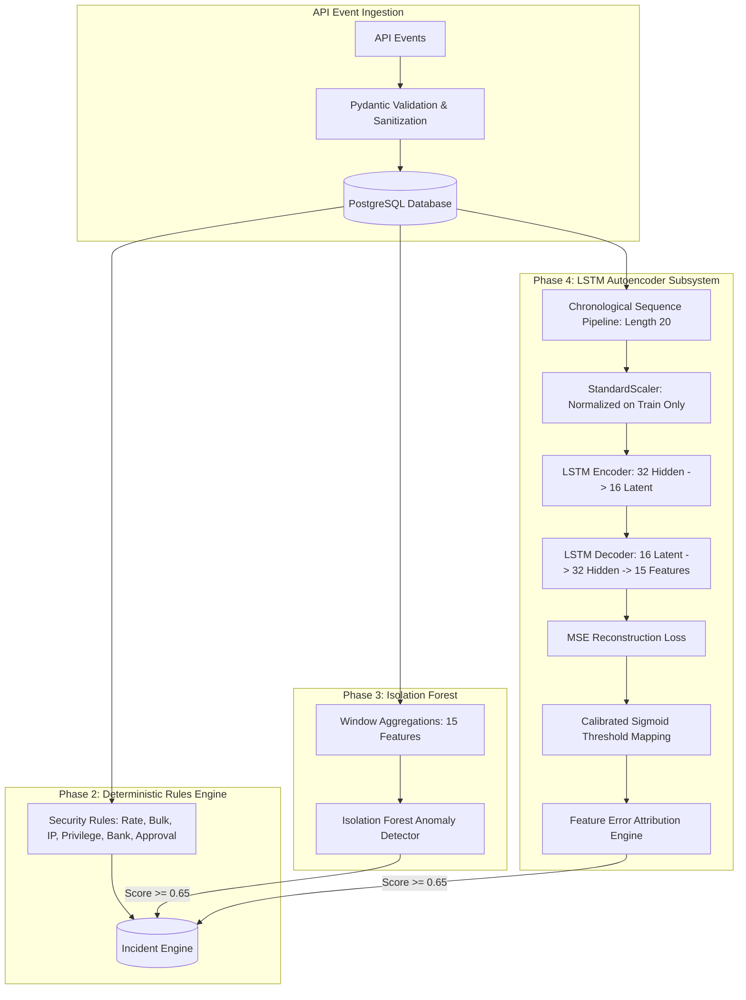
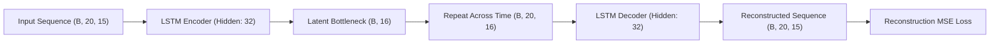

# SENTINEL — Phase 4: LSTM Autoencoder Sequential Anomaly Detection

## 1. Subsystem Overview

In Phase 4, SENTINEL introduces **deep learning-based sequential anomaly detection** using an **LSTM Autoencoder** implemented in PyTorch. While Phase 2 detects known deterministic violations and Phase 3 uses Isolation Forest to evaluate aggregate time-window features, Phase 4 evaluates **chronological sequences of API events**, identifying multi-step attack patterns, procedural order disruptions, and abnormal timing rhythms.

---

## 2. LSTM Autoencoder Architecture

The model compresses a sequence of 20 API events into a low-dimensional bottleneck representation and then reconstructs the original sequence. Legitimate API sequences are reconstructed with low Mean Squared Error (MSE), whereas anomalous sequences (exhibiting unexpected methods, off-hours timing, or unnatural cadence) fail reconstruction and yield high reconstruction error.

### Architecture Specifications
| Component | Hyperparameter / Layer | Purpose |
|:---|:---:|:---|
| **Input Shape** | $(B, 20, 15)$ | Batch of 20 consecutive chronological events with 15 features |
| **Encoder** | 1-layer LSTM (Hidden: 32) | Learns temporal dependencies across sequence timesteps |
| **Latent Projection** | Linear Layer $(32 \to 16)$ | Compresses sequence summary into low-dimensional latent code |
| **Decoder** | 1-layer LSTM (Hidden: 32) | Expands latent representation back across 20 timesteps |
| **Output Projection**| Linear Layer $(32 \to 15)$ | Generates reconstructed feature values |
| **Loss Metric** | Mean Squared Error (MSE) | Measures reconstruction fidelity |
| **Parameter Count** | **13,695 parameters** | Ultra-lightweight for CPU training and sub-5ms inference |

---

## 3. Data Pipeline & Zero-Leakage Normalization

### 3.1 Chronological Sequencing
1. Events are filtered strictly by `service_identity`. Events from different services are **never co-mingled**.
2. Events are sorted chronologically by UTC timestamp.
3. Feature extraction calculates inter-event intervals ($\Delta t = t_i - t_{i-1}$) strictly looking backwards, preventing future data leakage.

### 3.2 Train-Only Feature Normalization
- A `StandardScaler` is fitted **strictly on normal training sequences** ($N \times 20, 15$).
- Validation and test sequences are transformed using the fitted scaler parameters $(\mu, \sigma)$ without retraining or peeking.

---

## 4. Anomaly Scoring & Explainability

### 4.1 Calibrated Threshold Mapping
Raw reconstruction MSE is mapped into an explainable $[0.0, 1.0]$ score using a sigmoid function:

$$\text{relative\_overshoot} = \frac{\text{MSE} - \text{threshold}}{\text{threshold}}$$
$$\text{score} = \frac{1}{1 + e^{-6 \times \text{relative\_overshoot}}}$$

- When $\text{MSE} = \text{threshold}$, the score is approximately $0.50$.
- When $\text{MSE}$ significantly exceeds threshold, the score scales rapidly between $0.65$ and $1.00$.
- Any sequence with $\text{score} \ge 0.65$ generates an incident (`ML-ANOMALY-LSTM-001`).

### 4.2 Feature-Level Error Attribution
For each feature $d \in \{1, \dots, 15\}$, the per-feature reconstruction error is calculated:

$$\text{MSE}_d = \frac{1}{T} \sum_{t=1}^T (X_{t,d} - \hat{X}_{t,d})^2$$

Features are ranked by their error ratio relative to normal baseline reconstruction errors, identifying the exact root cause of the anomaly (e.g., unexpected method mutations, time-of-day shifts, payload explosions).

---

## 5. Model Comparison: LSTM Autoencoder vs. Isolation Forest

| Dimension | Phase 3 Isolation Forest | Phase 4 LSTM Autoencoder |
|:---|:---|:---|
| **Input Data** | Aggregated 300-second window vector | Chronological sequence of 20 individual events |
| **Detection Strength** | Volumetric bursts, high request counts, aggregate payload size | Multi-step transitions, cadence shifts, robotic bursts, ordered workflows |
| **Temporal Awareness** | Summary stats (variance, min/max) | Full step-by-step sequential dynamics ($t \to t+1$) |
| **Explainability** | Z-score feature deviations | Per-feature reconstruction error ratios |
| **Inference Latency** | $\approx 1.2\text{ ms}$ (CPU) | $\approx 3.5\text{ ms}$ (CPU) |
| **Complementary Value**| Flags massive bulk exports and volumetric scans | Flags subtle procedural shifts, robotic polling, and gradual privilege escalation |
