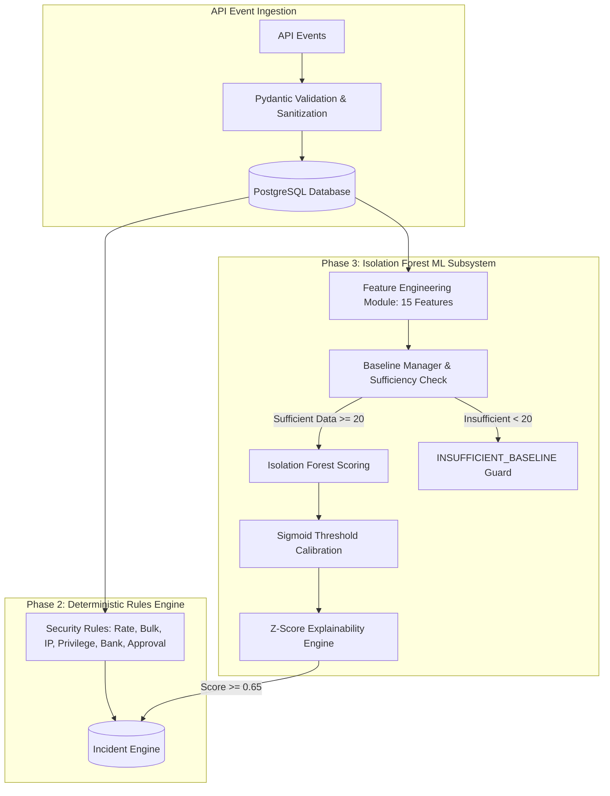

# SENTINEL — Phase 3: Isolation Forest Behavioral Anomaly Detection

## 1. Subsystem Overview

SENTINEL's Machine Learning subsystem complements deterministic security rules (Phase 2) by detecting subtle, multi-dimensional behavioral deviations that do not trigger static threshold violations. Using **Scikit-learn's Isolation Forest**, the subsystem learns normal API interaction baselines for each monitored service identity (`srv-ledgerone-core`, `srv-ledgerone-paygate`, `srv-helpdeskr-agent`, `srv-tallybridge-sync`) and flags statistical anomalies.

---

## 2. Behavioral Baseline Architecture

### 2.1 Service-Specific Baselines
In an enterprise environment, microservices have distinct operational profiles:
- **LedgerOne Core (`srv-ledgerone-core`)**: Financial queries, vendor record lookups, moderate traffic during business hours (08:00–19:00 UTC).
- **LedgerOne Payment Gateway (`srv-ledgerone-paygate`)**: High-value transactions, status checks, strict IP binding.
- **HelpDeskr Support (`srv-helpdeskr-agent`)**: Customer and vendor profile modifications, mixed read/write patterns.
- **TallyBridge Sync (`srv-tallybridge-sync`)**: Periodic batch ERP polling, high volume sync bursts, read-heavy.

Because a normal pattern for TallyBridge is anomalous for HelpDeskr, SENTINEL enforces **service-specific Isolation Forest models** rather than a single monolithic model.

### 2.2 Baseline Sufficiency Requirement
To prevent ungrounded predictions and false confidence:
- A minimum threshold of **20 feature observations** (`MIN_SAMPLES_FOR_BASELINE = 20`) is strictly enforced.
- If a service has fewer than 20 observations, the system returns `INSUFFICIENT_BASELINE` without guessing.
- Untrusted incoming traffic is **never** automatically folded into the trusted baseline. Model training is an explicit administrative operation.

---

## 3. Threshold Calibration & Anomaly Scoring

Scikit-learn's `IsolationForest.score_samples()` produces raw offset values typically falling between \(-0.3\) and \(-0.8\). Raw scores are not intuitive risk indicators.

SENTINEL employs a **calibrated sigmoid mapping**:

$$\text{score} = \frac{1}{1 + e^{-15 \times (\text{threshold} - \text{raw\_score})}}$$

- $\text{threshold}$ is calibrated during training as the 5th percentile ($\text{contamination} = 0.05$) of normal baseline scores.
- When $\text{raw\_score} = \text{threshold}$, the normalized anomaly score evaluates to approximately $0.50$.
- When an event deviates into anomaly territory ($\text{raw\_score} < \text{threshold}$), the score scales rapidly between $0.65$ and $0.99$.
- Anomaly incidents are raised only when $\text{score} \ge 0.65$.

### Incident Severity Mapping
| Calibrated Score | Severity | Risk Score Band | Action |
|:---|:---|:---|:---|
| $\ge 0.85$ | CRITICAL | 88 | Immediate triage, anomalous exfiltration / off-hours burst |
| $0.75 - 0.84$ | HIGH | 72 | Multi-feature deviation, abnormal writes |
| $0.65 - 0.74$ | MEDIUM | 55 | Moderate behavioral anomaly |
| $< 0.65$ | NORMAL | 0 | Conforming traffic, no incident created |

---

## 4. Explainability via Z-Score Feature Deviation

Black-box anomaly detection leads to alert fatigue. SENTINEL pairs every Isolation Forest detection with statistical feature deviation attribution:

$$Z_i = \frac{|x_i - \mu_i|}{\sigma_i}$$

Where $\mu_i$ and $\sigma_i$ are the learned baseline mean and standard deviation for feature $i$. The top deviations are ranked and embedded directly into the incident evidence and natural language summary.

**Example Incident Explanation:**
> `Behavioural anomaly detected for 'srv-ledgerone-core' by Isolation Forest (score: 0.78, threshold: 0.65). Top deviations: avg_response_size=28000000.0 (baseline: 2369.62, z=117628.75); total_bytes_transferred=84010500.0 (baseline: 20688.52, z=11766.0).`

---

## 5. Model Management & Persistence

- **Serialization**: Models are serialized using `joblib` with level-3 compression into `sentinel/backend/models_store/`.
- **Metadata Manifest**: Alongside `isoforest_{service}_v{version}.joblib`, a JSON manifest `isoforest_{service}_v{version}.json` records:
  - Feature schema version
  - Training timestamp
  - Sample count
  - Calibrated decision threshold
  - Feature means, standard deviations, and boundaries
  - Hyperparameters
- **Tamper & Schema Validation**: Upon loading, the model store verifies that deserialized artifacts are valid `IsolationForest` instances and match the 15-feature contract. Arbitrary untrusted files are rejected.

---

## 6. Fault Isolation & Performance

- **Non-blocking Event Persistence**: The ML detector is decoupled with a try-except boundary. If the ML module fails or a model file is corrupted, the API event is safely committed to PostgreSQL.
- **CPU Execution**: Operates smoothly within 16 GB RAM and Windows 11 CPU constraints without requiring dedicated GPUs, external ML clusters, or heavy distributed message queues.
