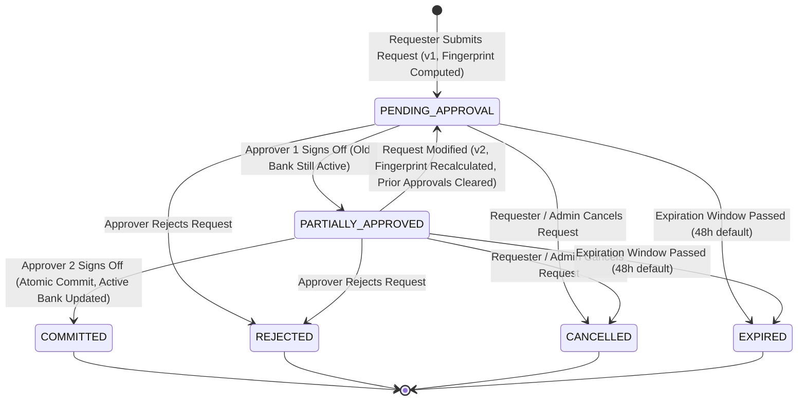

# SENTINEL — Phase 5: Two-Person Approval and Bank Change Enforcement

## 1. Overview and Threat Model

Unauthorized alteration of vendor bank account details is one of the highest-impact attack vectors targeting financial platforms (e.g. LedgerOne, TallyBridge). Common attack modes include:
1. **Business Email Compromise (BEC)**: Fraudulent requests masquerading as vendor representatives requesting urgent wire destination updates.
2. **Rogue Insider / Privilege Abuse**: A compromised requester attempting to redirect high-value disbursements to an offshore account.
3. **Session Hijacking / Credential Theft**: An attacker leveraging compromised credentials to silently update bank records.
4. **Race Conditions / Concurrency Attacks**: Parallel HTTP requests attempting to bypass approval order checks.

To counter these threats deterministically, SENTINEL Phase 5 introduces a **cryptographically bound, dual-authorization, atomic enforcement engine** for vendor bank details.

---

## 2. Core Security Invariants

The backend deterministically enforces the following non-negotiable principles:

| Rule | Description | Enforcement Mechanism |
|---|---|---|
| **Two-Person Rule** | No bank account change becomes active until two different authorized human users independently approve the exact same change request. | Counter verification in DB transaction (`approvals_required = 2`). |
| **Anti-Self-Approval** | The requester cannot approve their own request under any circumstance, even if holding admin roles. | Checked against request `requester_id` before role validation (`403 SelfApprovalProhibited`). |
| **Anti-Duplicate Approval** | The same approver cannot approve twice. | Unique set constraint on approver IDs across request approvals (`400 DuplicateApprovalProhibited`). |
| **Active Bank Account Invariance** | The old bank account remains completely active and un-tampered until both approvals are valid and the atomic database transaction commits. | Vendor record update deferred exclusively to Step 8 of second approval transaction. |
| **Cryptographic Immutability** | Approvals are bound to a canonical SHA-256 fingerprint. Any parameter change invalidates prior approvals and resets the workflow. | Canonical JSON hashing (`compute_change_fingerprint`); version increment on edit. |
| **Encryption at Rest** | Sensitive account details (account numbers, routing numbers) are never stored in plaintext. | AES-128-CBC + HMAC-SHA256 authenticated encryption via Fernet. |
| **Plaintext Data Masking** | Plaintext account numbers are strictly prohibited in API responses, logs, and telemetry. | Masked references (`ACC-***masked***1048`, `ROUT-***0021`). |
| **Concurrency Safety** | Concurrent approval or modification attempts are serialized without race conditions. | Row-level locking (`SELECT ... FOR UPDATE`) inside atomic database transactions. |
| **AI Non-Interference** | Machine learning components (Isolation Forest, LSTM Autoencoder) never make authorization decisions. | Purely deterministic state machine; ML detection only produces analytical incidents. |

---

## 3. Workflow Lifecycle State Machine



### 10-Step Execution Lifecycle
1. **Request Submission**: Authorized requester (`REQUESTER` role) submits proposed bank details.
2. **Identity & Vendor Validation**: SENTINEL verifies requester status (`ACTIVE`) and vendor existence.
3. **Encryption & Fingerprinting**: SENTINEL generates canonical SHA-256 fingerprint and encrypts details with Fernet key.
4. **Pending State Entry**: Request enters `PENDING_APPROVAL` with `approval_count = 0`. Incident `SEC-RULE-BANK-001` is logged.
5. **First Approval**: First authorized approver (`FINANCE_APPROVER`) reviews. Transitions to `PARTIALLY_APPROVED`. **Old bank account remains active.**
6. **Second Approval Verification**: Second approver signs off. SENTINEL checks that `approver_1 != approver_2` and `approver_2 != requester`.
7. **Integrity Validation**: Recomputes canonical fingerprint against stored hash to guarantee no mid-flight tampering occurred.
8. **Atomic Commit**: Within a database row lock (`with_for_update()`), SENTINEL writes new bank details to `vendor_bank_accounts`, updates `version`, and marks request `COMMITTED`.
9. **Post-Commit Immutability**: Any subsequent approval attempts on `COMMITTED` requests are rejected (`400 Bad Request`).
10. **Immutable Audit Preservation**: Every state transition, approval signoff, and failed attempt is permanently recorded in `bank_approval_audit_logs`.

---

## 4. Role-Based Access Control (RBAC)

The development authentication adapter enforces independent identity extraction via HTTP headers (`X-User-Id` or `Authorization: Bearer dev-token-*`).

| Role | Permissions |
|---|---|
| `REQUESTER` | Submit bank change requests; cancel own pending requests; modify own pending requests. Cannot approve. |
| `FINANCE_APPROVER` | Review, approve, or reject bank change requests. Cannot approve own requests. |
| `FINANCE_ADMIN` | Submit requests; approve requests (where not the requester); cancel any pending request; modify requests. |
| `AUDITOR` | Read-only inspection of active bank details, change request queues, and immutable audit logs. |

---

## 5. Cryptography and Data Privacy Specification

### Canonical Fingerprint Algorithm
To guarantee that both approvers approve the exact same data without tampering:
```python
def compute_change_fingerprint(
    vendor_id: str,
    old_account_ref: str,
    proposed_account_ref: str,
    proposed_bank_name: str,
    proposed_routing_masked: str,
    requester_id: str,
    version: int
) -> str:
    canonical = {
        "vendor_id": vendor_id.strip(),
        "old_account_ref": old_account_ref.strip(),
        "proposed_account_ref": proposed_account_ref.strip(),
        "proposed_bank_name": proposed_bank_name.strip(),
        "proposed_routing_masked": proposed_routing_masked.strip(),
        "requester_id": requester_id.strip(),
        "version": int(version)
    }
    raw = json.dumps(canonical, sort_keys=True, separators=(",", ":"))
    return hashlib.sha256(raw.encode("utf-8")).hexdigest()
```

### Encryption at Rest
All sensitive proposed details are packaged into a JSON dictionary and encrypted with Fernet (AES-128 in CBC mode with PKCS7 padding and HMAC-SHA256 authentication).
Key is configured via `BANK_ENCRYPTION_KEY` environment variable.

### Data Masking Standard
- Account Numbers: `ACC-***masked***<last_4_digits>` (e.g. `ACC-***masked***1048`)
- Routing Numbers: `ROUT-***<last_4_digits>` (e.g. `ROUT-***0021`)
- Plaintext account numbers are strictly discarded after encryption.

---

## 6. REST API Reference

### Endpoints

| Method | Path | Required Role | Description |
|---|---|---|---|
| `POST` | `/api/v1/bank-changes` | `REQUESTER`, `FINANCE_ADMIN` | Submit bank change request |
| `GET` | `/api/v1/bank-changes` | Authenticated | List change requests (filterable by `vendor_id`, `status`) |
| `GET` | `/api/v1/bank-changes/{request_id}` | Authenticated | Get detailed status and approval chain |
| `POST` | `/api/v1/bank-changes/{request_id}/approve` | `FINANCE_APPROVER`, `FINANCE_ADMIN` | Authorize approval step |
| `POST` | `/api/v1/bank-changes/{request_id}/reject` | `FINANCE_APPROVER`, `FINANCE_ADMIN` | Reject change request |
| `POST` | `/api/v1/bank-changes/{request_id}/cancel` | `REQUESTER` (owner), `FINANCE_ADMIN` | Cancel pending request |
| `GET` | `/api/v1/bank-changes/{request_id}/audit` | Authenticated | Retrieve immutable audit trail |
| `GET` | `/api/v1/vendors/{vendor_id}/bank-account` | Authenticated | Retrieve active vendor bank details (masked) |

---

## 7. Audit Log Schema (`bank_approval_audit_logs`)

All actions produce immutable entries in `bank_approval_audit_logs`:

```sql
CREATE TABLE bank_approval_audit_logs (
    id SERIAL PRIMARY KEY,
    request_id VARCHAR(64) NOT NULL,
    actor_id VARCHAR(100) NOT NULL,
    action VARCHAR(50) NOT NULL,
    result VARCHAR(20) NOT NULL,
    evidence JSONB DEFAULT '{}',
    created_at TIMESTAMP WITH TIME ZONE NOT NULL
);
```

Recorded actions include: `CREATE_REQUEST`, `FIRST_APPROVAL`, `SECOND_APPROVAL`, `COMMIT_CHANGE`, `REJECT_REQUEST`, `CANCEL_REQUEST`, `MODIFY_REQUEST`, `EXPIRE_REQUEST`, `TAMPER_DETECTED`.
