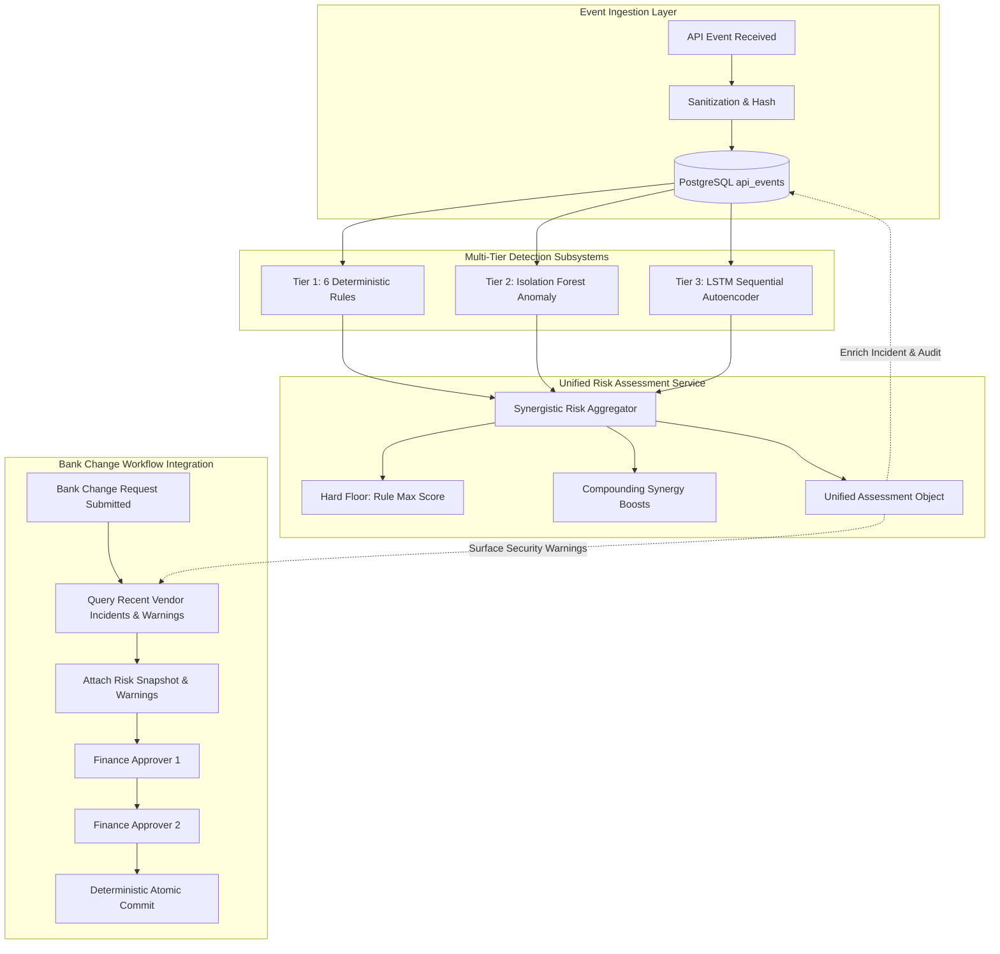

# SENTINEL — Phase 6: Unified Detection and Approval Integration Architecture

## 1. Executive Architectural Overview

SENTINEL Phase 6 integrates all previous detection and enforcement subsystems into a unified, synergistic security workflow:

1. **Deterministic Security Detection Engine** (Phase 2): 6 configurable security policy rules detecting known protocol, IP, rate, and privilege violations.
2. **Isolation Forest Behavioral Anomaly Detector** (Phase 3): Point-in-time statistical outlier detection across 15 behavioral features.
3. **LSTM Autoencoder Sequential Anomaly Detector** (Phase 4): Deep learning sequence reconstruction modeling 20-event chronological chains per service.
4. **Two-Person Bank Change Authorization Engine** (Phase 5): Deterministic dual human authorization with Fernet encryption at rest and atomic commit.

---

## 2. Synergistic Risk Aggregation Strategy

A fundamental vulnerability in naive multi-model architectures is "blind score averaging," where an uncalibrated ML model (reporting 0) dilutes a high-severity deterministic rule breach (score 85), causing the alert to drop into LOW or MEDIUM severity.

SENTINEL employs a **documented, configurable synergistic risk aggregation algorithm**:

### Step 1: Component Score Extraction
- **Deterministic Rules ($S_{\text{rule}}$)**:
  $$S_{\text{rule}} = \max(\{r.\text{risk\_score} \mid r \in R_{\text{triggered}}\} \cup \{0\})$$
- **Isolation Forest ($S_{\text{if}}$)**:
  If evaluated and triggered: $S_{\text{if}} = \text{round}(\text{norm\_score} \times 100)$. Otherwise 0.
- **LSTM Autoencoder ($S_{\text{lstm}}$)**:
  If evaluated and triggered: $S_{\text{lstm}} = \text{round}(\text{norm\_score} \times 100)$. Otherwise 0.

### Step 2: Deterministic Hard Floor
$$S_{\text{base}} = \max(S_{\text{rule}}, S_{\text{if}}, S_{\text{lstm}})$$
The deterministic finding acts as a non-negotiable floor that machine learning models cannot lower.

### Step 3: Missing / Unavailable Model Invariant
If a model's status is `UNAVAILABLE`, `UNTRAINED`, or `INSUFFICIENT_DATA`:
- `evaluated = False`
- The model contributes 0 to the score, but is **explicitly flagged as unassessed in the explanation** (`"Note: Model status was UNAVAILABLE and was not evaluated (not assumed normal)"`).
- An unavailable model NEVER decreases the risk score or grants false confidence.

### Step 4: Cross-Tier Compounding Synergy Boosts
When multiple independent detection tiers confirm anomalous activity on the same event or sequence:
- **Dual Confirmation** (e.g. Rule + IF, or Rule + LSTM, or IF + LSTM): $+10$ points synergy boost.
- **Triple Confirmation** (Rule + IF + LSTM all trigger): $+15$ points synergy boost.

### Step 5: Bounded Clamping & Severity Mapping
$$\text{Final Risk Score} = \min(100, \max(0, S_{\text{base}} + \text{boost}))$$

| Score Range | Severity Band | Operational Action |
|:---:|:---:|---|
| **0 – 29** | `LOW` | Normal operational traffic. Preserved in telemetry. |
| **30 – 59** | `MEDIUM` | Minor behavioral drift or low-risk threshold warning. Monitored. |
| **60 – 84** | `HIGH` | Verified policy violation or significant ML outlier. Incident generated. |
| **85 – 100** | `CRITICAL` | Severe violation (privilege abuse, bank tampering) or multi-tier alert. Immediate triage. |

---

## 3. Bank-Change Security Integration

### The Non-Bypass Invariant
> [!CRITICAL]
> **AI risk scores must NEVER replace human approvals.**
> Under no circumstances can an AI decision auto-approve, bypass, or shortcut the two-person bank change authorization workflow.

### Workflow with Risk Context
1. **Request Submission**: Requester submits bank change.
2. **Vendor Incident Correlation**: SENTINEL queries all security incidents and unified assessments associated with `vendor_id` and `requester_id` from the previous 48 hours.
3. **Risk Snapshot & Warnings**:
   - Compiles structured security warnings: e.g. `"[SECURITY WARNING - HIGH] Incident 5b7753c9: Bulk Vendor Data Access (Risk Score: 75)"`.
   - Attaches `linked_incident_ids` and `risk_assessment_snapshot` to the `BankChangeRequest`.
4. **Finance Reviewer Visibility**:
   - Authorized finance approvers review the request and query `GET /api/v1/bank-changes/{id}/risk-assessment`.
   - Approvers see full contextual warnings before signing off.
5. **Deterministic Two-Person Enforcement**:
   - Approver 1 signs off -> `PARTIALLY_APPROVED`. (Old bank account remains active).
   - Approver 2 signs off -> `COMMITTED`. (New bank account activated atomically).
   - Even if the AI risk score is 0 (completely clean) or 100 (critical threat), **both human approvals are strictly mandatory**.

---

## 4. API Endpoints Specification

| Method | Path | Required Role | Description |
|---|---|---|---|
| `GET` | `/api/v1/assessment/events/{event_id}` | Authenticated | Retrieve multi-tier risk assessment for an event |
| `POST` | `/api/v1/assessment/evaluate` | Authenticated | Run on-demand unified assessment for an event |
| `GET` | `/api/v1/assessment/summary` | Authenticated | System-wide analytics across all detection tiers |
| `GET` | `/api/v1/incidents/{incident_id}/assessment` | Authenticated | Detailed combined assessment for an incident |
| `GET` | `/api/v1/bank-changes/{request_id}/risk-assessment` | `FINANCE_APPROVER`, `FINANCE_ADMIN`, `AUDITOR` | Security warnings and risk snapshot for bank changes |

---

## 5. Security & Privacy Controls
1. **Role-Based Access Control**:
   - Sensitive bank change risk assessments are restricted to authorized finance roles (`FINANCE_APPROVER`, `FINANCE_ADMIN`, `AUDITOR`).
   - Unauthorized attempts receive `403 Forbidden` (`AccessDenied`).
2. **Sensitive Data Masking**:
   - Plaintext account numbers and API credentials are completely redacted from all assessment payloads, audit logs, and explanations.
   - Bank accounts appear only in masked format (`ACC-***masked***1048`).
3. **Deduplication & Correlation**:
   - Multi-tier evaluations avoid incident flooding by deduplicating against active incidents within the configured correlation window (`CORRELATION_WINDOW_SECONDS`).
